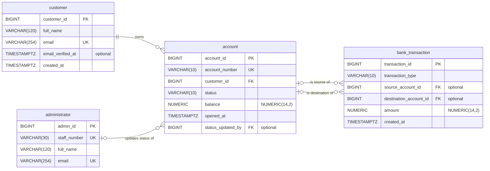

# Digital Banking and Fintech Platform ER Diagram

## Keys

**PK (primary key)** is the field that identifies each row, such as account_id in account. No two rows share a PK value, and it is never empty.

**FK (foreign key)** is a field that points to a PK in another table. For example, customer_id in account must match an existing customer.

**UK (unique key)** is a field that cannot repeat but is not the main identifier. Examples are email, staff_number and account_number.

## Relationship symbols

Each line has a symbol at each end. The symbol next to a table shows how many rows of that table can link to one row at the other end.

| Symbol | Meaning |
| --- | --- |
| `\|\|` | Exactly one |
| `\|o` | Zero or one |
| `o{` | Zero or many |

- **customer ||--o{ account:** each account belongs to exactly one customer, and a customer has zero or more accounts.
- **administrator |o--o{ account:** an account has zero or one latest status updater, and an administrator updates zero or more accounts.
- **account |o--o{ bank_transaction (source):** a transaction has zero or one source account, because deposits have none. An account sends zero or more transactions.
- **account |o--o{ bank_transaction (destination):** a transaction has zero or one destination account, because withdrawals have none. An account receives zero or more transactions.

**Example:** a customer with two accounts appears once in customer and twice in account. Both account rows hold the same customer_id. A ₦5,000 transfer from one account to the other is a single bank_transaction row whose source_account_id and destination_account_id point to those two accounts.

## Optional fields

The optional fields are email_verified_at, status_updated_by, source_account_id and destination_account_id. All other fields are required.

## Rules needing more than keys

The diagram shows keys and how many rows link, but these rules need extra constraints or transaction logic:

- **CHECK constraints:**
  - status is active, suspended or closed.
  - balance ≥ 0 and amount > 0.
  - transaction_type matches which account fields are filled in.
  - The source and destination of a transfer are different accounts.
- **Trigger:** a transaction's created_at is not earlier than the account's opened_at.
- **Transaction logic:**
  - Accounts must be active before money moves.
  - The email must be verified before an account is opened.
  - Each money movement inserts its bank_transaction row and updates the balances together, so all changes succeed or none do.
- **Permissions:** bank_transaction rows are never deleted or updated, and ON DELETE RESTRICT stops removing accounts that have transaction history.